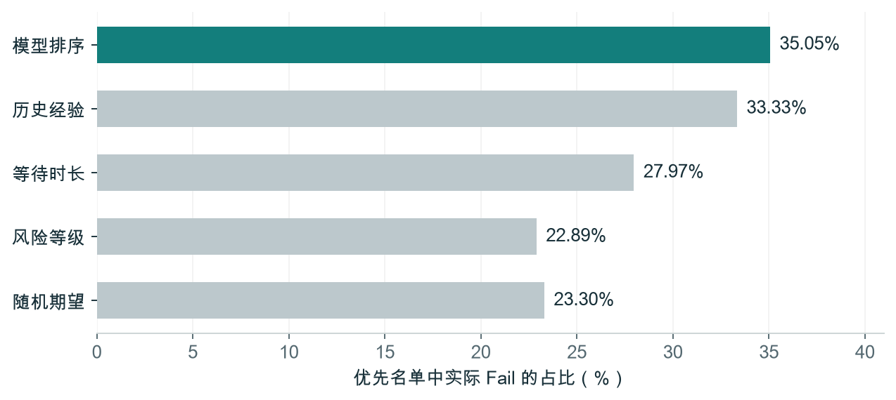

# 先查哪家？餐饮巡检风险排序与覆盖审计

**Inspection Priority Audit** · Python / SQL / 决策分析

每月只有约 20% 的优先检查名额，历史记录能否比简单经验捕获更多不合格结果？如果兼顾地区覆盖，命中率要付出多大代价？

本项目使用芝加哥政府公开巡检记录，构建按月份冻结信息的回顾性排序实验，对比预测模型、经验规则和地区配额策略。

分析支持两个管理决策：模型相比经验规则增加的命中是否值得维护成本；兼顾地区覆盖时，需要接受多大的命中率下降。交付包括可复现分析、策略对比、研究报告和历史候选解释。

[在线交互演示](https://gongsjie3-cyber.github.io/inspection-priority-audit/) · [五页研究报告](项目报告.pdf) · [交互报告文件](项目展示.html) · [方法与字段说明](方法与字段说明.md) · [原始数据来源](https://data.cityofchicago.org/d/4ijn-s7e5)

> **评价范围：** 候选池由每月实际接受例行检查且有有效结果的餐饮记录事后构造。以下结果衡量已受检样本的排序表现，不代表真实月初可检查名单，也不是已经上线的检查排程效果。

## 主要结果

2019—2025 年共有 **123,673 条**公开记录，形成 **29,520 条**目标样本。2024—2025 年时间留出集包含 **11,869 条**样本、2,765 条 Fail。每月取 `ceil(0.2 × 候选数)`，测试期合计 **2,385 个**名额。

| 策略 | 捕获 Fail | 命中率 | 召回率 |
|---|---:|---:|---:|
| 月内随机选择（期望） | 555.68 | 23.30% | 20.10% |
| 历史高风险等级优先 | 546 | 22.89% | 19.75% |
| 最长未例检优先 | 667 | 27.97% | 24.12% |
| 历史不合格优先 | 795 | 33.33% | 28.75% |
| **逻辑回归排序** | **836** | **35.05%** | **30.24%** |
| 50% 地区比例配额 + 分数补齐 | 804 | 33.71% | 29.08% |



- **强基线很重要：** 模型比最强经验规则多捕获 41 条 Fail，命中率提高 1.72 个百分点。相对随机的 50.45% 捕获数提升不能解释为节省人力。
- **复杂模型未必胜出：** 在预设的两个配置中，2023 年 1—11 月验证集选择了逻辑回归，其 Precision@20% 为 38.97%，梯度提升树为 38.31%。
- **地区覆盖有代价：** 预留 50% 名额按历史邮编构成分配后，比纯模型少捕获 32 条，平均构成偏离度 TV 从 0.291 降至 0.237。该比例是政策情景，不是自动认定的最优解。
- **优势对假设敏感：** 主分析假设信息延迟 14 天，模型与经验规则差值的月份 bootstrap 95% 区间为 +0.29 至 +3.05 个百分点；改为 30 天后为 -0.24 至 +2.30 个百分点，包含零。
- **无历史对象是弱点：** 测试集 76 条无历史记录中有 18 条 Fail，模型只捕获 1 条，需要单独研究探索或必查名额。

## 实验设计

1. **实体与标签。** 以“许可证＋规范化地址”识别对象；排除同日冲突及非评价结果。目标仅包含 Restaurant 的 Canvass 例行检查，同店同月保留第一次；Fail 为正类，Pass 与 Pass w/ Conditions 为负类。
2. **信息时点。** 每月 1 日冻结特征，仅使用严格早于“月初减 14 天”的历史检查。当前检查结果、违规文本、当前风险等级均不入模；历史风险只取过去记录。
3. **时间验证。** 2019 年预热，2020—2022 年训练，2023 年 1—11 月选择模型，2024—2025 年留出测试。为确保 2024 年初选模型时标签已经可用，验证阶段排除整个 2023 年 12 月；训练与最终重训也遵守信息延迟约束。测试期模型固定、历史特征逐月更新。
4. **预算一致。** 所有策略的月度名额完全相同；并列以固定哈希实体键排序，不读取标签。随机规则报告数学期望。
5. **覆盖约束。** 预留名额按候选池历史邮编构成使用最大余数法分配，组内按模型分数选择，其余名额全局补齐。
6. **独立核验。** 用 SQL 检查历史关联数量和每月前 20% 排名；测试时间泄漏、标签盲选、固定预算和快照完整性。

## 快速查看

- 打开 [在线演示](https://gongsjie3-cyber.github.io/inspection-priority-audit/)，可直接切换预算与历史月份，也可在线阅读 PDF，无须安装环境。
- 直接阅读 [PDF 报告](项目报告.pdf)。
- 下载仓库后，用浏览器打开 `项目展示.html`，可切换预算和历史月份；页面不依赖外部服务。
- [主分析结果](results/lag14/policies.csv)、[30 天敏感性结果](results/lag30/policies.csv)、[逐年结果](results/lag14/yearly.csv) 可直接查看。

## 复现

推荐 **Python 3.12**。仓库包含本次分析的最小列数据快照，无须重新下载即可复现。SQLite 审计数据库由流水线生成，不提交到仓库。

```bash
python -m venv .venv
source .venv/bin/activate
# Windows PowerShell: .venv\Scripts\Activate.ps1
python -m pip install -r requirements.txt

python src/pipeline.py
python src/pipeline.py --lag 30
python -m unittest discover -s tests -v
python src/build_report.py
```

先完成 14 天主分析和 30 天敏感性分析，再运行测试；SQLite 数据库由主分析生成。17 项数据与决策核验已在附带快照上通过，详见 [核验说明](核验说明.md) 和 [机器可读核验记录](results/verification.json)。

报告正文对应本次冻结实验；图表和交互表读取结果文件。更换数据或方法后需同步复核正文，生成器会在已审核指标文件的校验值变化时停止，避免输出过期叙述。

生成中文图表和 PDF 时，macOS 优先使用 Arial Unicode。其他系统可设置 `PROJECT_CJK_FONT` 为支持中文的 TrueType 字体路径，并检查生成文件的中文显示。

若需重新获取官方历史导出，可运行 `python src/download.py`。官方后续修订可能改变结果，新的导出也会更新来源清单；请先保留原快照。

## 在线演示的发布

GitHub Pages 从 `main` 分支的 `docs/` 目录发布。页面和 PDF 来自本仓库已核验的交付文件；页面内嵌图表与预计算数据，交互不调用模型服务。

更新分析后，先重新核验报告并更新 `results/verification.json` 中的交付文件校验值，再运行：

```bash
python src/prepare_pages.py
python src/prepare_pages.py --check
```

将生成的 `docs/` 一并提交并推送后，GitHub Pages 会重新部署。打包脚本会拒绝发布与核验记录不一致的报告。

## 目录

| 路径 | 内容 |
|---|---|
| `src/` | 官方数据下载、清洗、特征、模型、分配和报告生成 |
| `sql/` | 历史关联与排名的交叉核验 |
| `tests/` | 17 项时间、标签、预算和结果一致性核验 |
| `data/` | 最小列官方快照、来源 URL 与 SHA-256 清单 |
| `results/verification.json` | 最近一次核验记录与文件校验值 |
| `results/lag14/` | 主分析指标、逐月结果和历史候选评分 |
| `results/lag30/` | 固定模型类别后的信息延迟敏感性分析 |
| `figures/` | 策略、预算、覆盖及月度稳定性图表 |
| `docs/` | GitHub Pages 在线演示及已核验的 PDF 副本 |

## 适用边界

- 只能评估已受检且有有效结果的候选，存在检查选择偏差；不能推广到全部商户。
- Fail 是行政检查结果，不等于严重违规、疾病或疾病概率。
- 14 / 30 天发布延迟均是假设；当前导出缺少真实历史发布时间和版本，无法完全恢复当时可用信息。
- 2019 年之前历史截断、许可证或地址变化，可能影响历史特征和实体匹配。
- 月份重采样区间未完全处理同店跨月相关性。
- 邮编比例约束衡量候选构成的接近程度，不证明人口或服务需求公平。
- 未测量真实人力、路线、检查时长及因果效应，因而不报告实际节约成本或提前发现天数。

## 来源与研究背景

- [City of Chicago: Food Inspections, 4ijn-s7e5](https://data.cityofchicago.org/d/4ijn-s7e5)。快照下载于 2026-10-10；查询条件、列与校验值见 [manifest](data/manifest.json)。数据来自原发布方，使用应遵守其适用条款。
- [Chicago Food Inspection Forecasting](https://github.com/Chicago/food-inspections-evaluation)：既有业务应用与公开实现。
- [Kannan et al. (2019), Hindsight Analysis of the Chicago Food Inspection Forecasting Model](https://arxiv.org/abs/1910.04906)：模型、数据与评价假设的审视。
- [Singh et al. (2022), Fair Decision-Making for Food Inspections](https://arxiv.org/abs/2108.05523)：检查排序中的地域差异与公平性研究。

食品巡检预测已有前人工作。本项目的重点是信息时点审计、经验基线及固定预算下的覆盖取舍，不声称学术首创或复现上述论文。

本项目使用 AI 辅助编写文档，并保留可复现流程与核验记录；属于个人研究，非政府官方产品，无真实业务部署。
